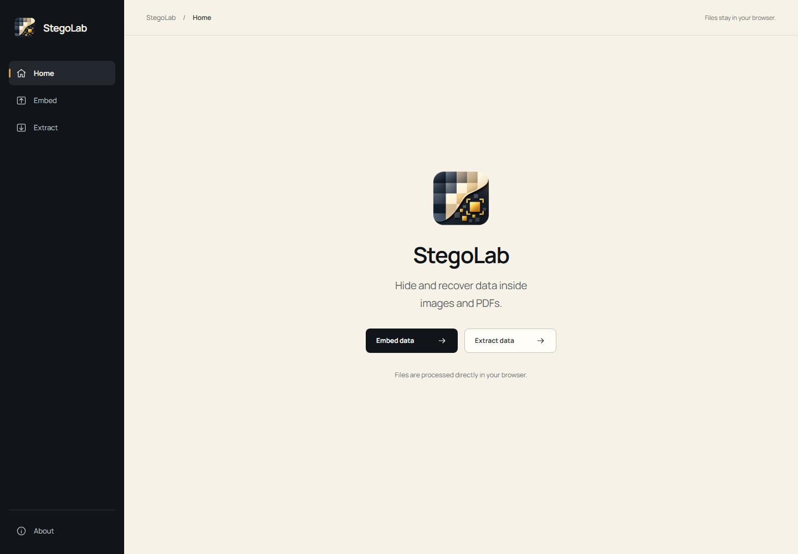
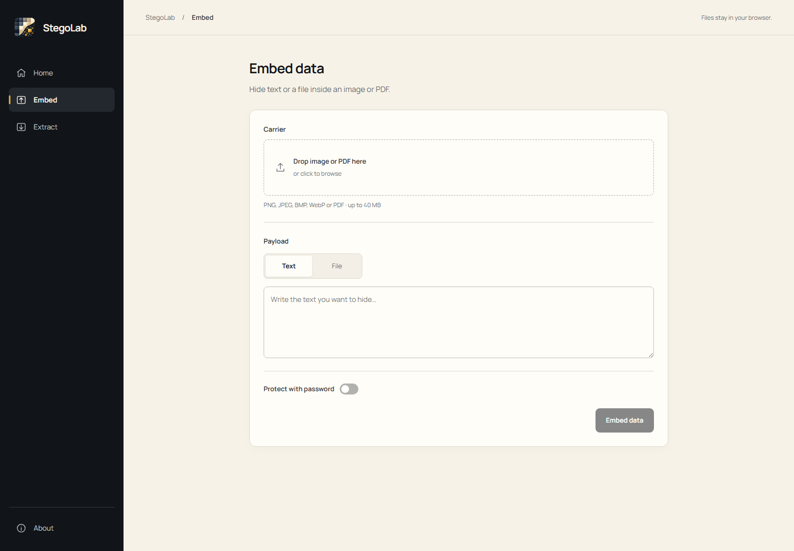
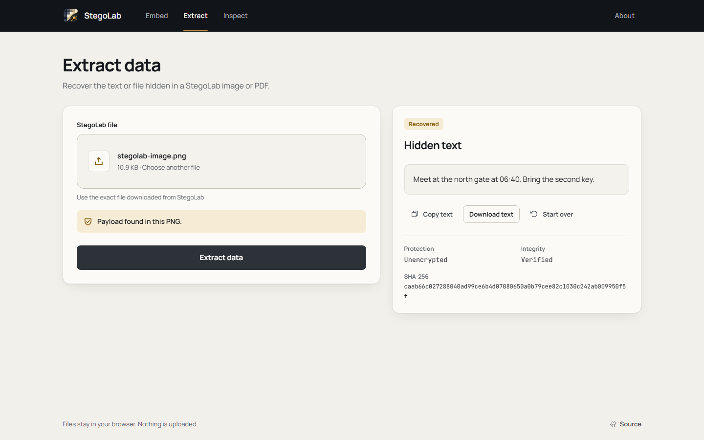

<p align="center"></p>

# StegoLab

Hide and recover data inside images and PDFs. Everything is processed in your browser.

[](https://stegolabsec.netlify.app/)

## Overview

StegoLab keeps the workflow small: choose **Embed** to hide text or a file, or **Extract** to recover it. Optional password protection encrypts the payload before it enters the carrier. No account or installation is needed to use a deployed site.

## Features

- Embed text or arbitrary small files in supported images and PDFs.
- Recover exact text, or download a recovered file with its original name.
- Protect payloads with a password and authenticated encryption.
- Check capacity automatically and verify saved output before offering a download.
- Process files in the browser, with no upload or persistent operation records.

## Screenshots



| Embed | Extract |
|---|---|
| [](docs/screenshots/embed.png) | [](docs/screenshots/extract.png) |

These are actual production UI captures. [Mobile form](docs/screenshots/mobile-embed.png).

## How it works

**Embed:** select carrier → package text/file → encrypt if requested → embed → verify saved output → download.

**Extract:** upload generated carrier → discover payload → decrypt if required → verify integrity → display text or download file.

## Supported formats

Every row passed browser tests for text, binary-file hashes and password-protected payloads.

| Format | Accepted input | Output | Technique | Verified |
|---|---|---|---|---|
| PNG | Static PNG | PNG | One RGB bit in fully opaque pixels | Yes |
| JPEG / JPG | Static JPEG, both extensions | JPG | Ordered APP15 application segments; image data preserved | Yes |
| BMP | Uncompressed 24/32-bit BMP | BMP | One RGB bit; padding and alpha bytes preserved | Yes |
| WebP | Static WebP | WebP | Custom RIFF chunk; image data preserved | Yes |
| PDF | Unsigned, unencrypted PDF | PDF | Standard embedded file plus catalog reference | Yes |

PNG is saved as a lossless PNG. JPEG and WebP use containers because recompression can destroy pixel embedding. PDF payloads use an embedded-data container and may be visible to PDF attachment or forensic tools.

## Privacy

Files, payloads and passwords are handled in browser memory and are not uploaded to StegoLab. Refreshing clears application state. Downloads remain wherever you save them. Fonts and assets are bundled locally; the host still receives normal site requests. Browser extensions and device security are outside the application's privacy guarantees.

## Security

Password protection uses **AES-256-GCM**, a fresh 16-byte salt, a fresh 12-byte nonce and **PBKDF2-HMAC-SHA-256 with 600,000 iterations** through Web Crypto. Metadata and payload bytes are authenticated together. Wrong passwords and modified encrypted data fail without partial recovery.

Unencrypted payloads use SHA-256 corruption checks; these do not provide authenticity or secrecy. Passwords are never persisted by the app. See [security notes](docs/SECURITY.md) and [payload format](docs/PAYLOAD_FORMAT.md).

## Limitations

- Keep generated carriers unchanged. Editing, resizing, recompression and metadata removal may destroy data.
- Capacity depends on the carrier. Limits are 40 MiB per carrier, 8 MiB per payload, 16 million pixels and 200 PDF pages.
- Animated images, compressed/paletted BMP variants, signed PDFs and encrypted PDFs are unsupported.
- Use a fresh original carrier; re-embedding in generated carriers is rejected.
- Container data can be inspected. StegoLab does not guarantee undetectability or recover forgotten passwords.
- Earlier StegoLab files use a different format and cannot be recovered by this browser edition.
- Acceptance testing covers desktop Chromium and mobile viewport emulation; other browser engines and physical devices need separate validation.

## Run locally

Use Node.js 22.12+ or 24 LTS. From this repository:

```sh
cd frontend
npm ci
npm run dev
```

Open the URL Vite prints. There are no runtime credentials or environment variables to configure.

## Production build

From `frontend/`:

```sh
npm run build
npm run preview
```

Deploy the contents of `frontend/dist/`. The deployed app requires only static hosting over HTTPS; Node is a build/development tool.

## Deployment

**Netlify:** connect the repository. The root `netlify.toml` sets base `frontend`, command `npm run build` and publish directory `dist`. It includes a navigation fallback and security headers. No functions are required.

**GitHub Pages:** select **GitHub Actions** under repository Settings → Pages, then run the included **Deploy static site to GitHub Pages** workflow manually. Vite uses relative asset paths, and routes use `#/embed` and `#/extract`, so the same build works under a repository subpath.

The setup follows [Netlify's static SPA guidance](https://docs.netlify.com/build/configure-builds/javascript-spas/) and [GitHub's Pages workflow guidance](https://docs.github.com/en/pages/getting-started-with-github-pages/using-custom-workflows-with-github-pages).

## Project structure

```text
frontend/             React UI, shared browser modules and unit tests
e2e/                  Synthetic production-browser acceptance tests
docs/                 Architecture, security, validation and screenshots
.github/workflows/    Frontend CI and manual Pages deployment
netlify.toml          Static Netlify configuration
```

## Testing

From the repository root:

```sh
npm ci --prefix frontend
npm run lint --prefix frontend
npm run typecheck --prefix frontend
npm test --prefix frontend
npm run build --prefix frontend
npm audit --prefix frontend
npm ci --prefix e2e
node e2e/node_modules/@playwright/test/cli.js install chromium
npm test --prefix e2e
```

Browser tests serve only the production build, generate synthetic inputs and compare downloaded results. [Validation evidence](docs/VALIDATION.md) records commands and results. [Quick manual checks](docs/MANUAL_TESTING.md) cover the main user journeys.

## License

[MIT](LICENSE). The existing project license is preserved. [Third-party attribution](docs/ATTRIBUTION.md).

## Author

Designed and built by [Mosaddiqur Rahman ↗](https://www.linkedin.com/in/mosaddiqur/).

